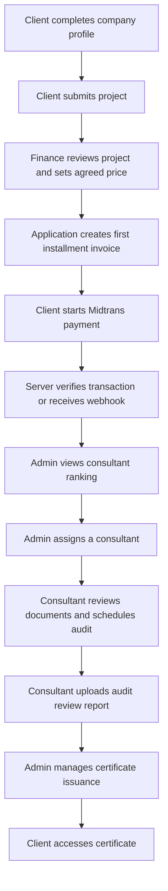
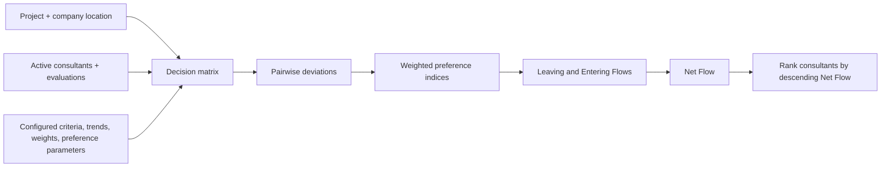
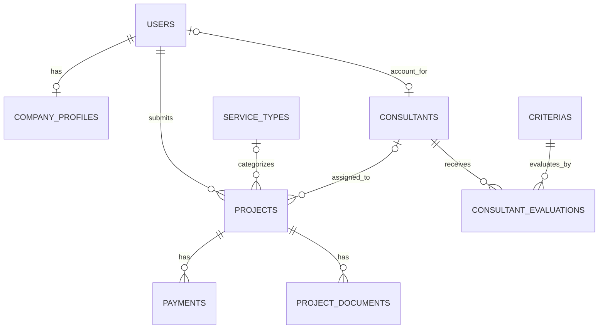

# Halal Consultant Recommendation and Certification Management System

A Laravel web application for managing halal certification assistance projects and recommending consultants through a configurable PROMETHEE II multi-criteria decision process.

## Project Overview

The application supports clients submitting certification projects, administrators reviewing consultant recommendations and assigning a consultant, consultants handling project documents and audit work, and finance staff managing agreed prices, invoices, and payment monitoring.

Its main technical focus is a service-layer PROMETHEE II implementation that ranks active consultants using configured criteria, criterion weights, preference functions, industry specialization matching, consultant evaluations, and Haversine distance. The application also integrates Midtrans Snap and transaction verification/webhook handling for payment status updates.

## Key Features

### Authentication and roles
- Laravel authentication routes and session-based login.
- Role-based route groups for `admin`, `klien`, `konsultan`/`consultant`, and `keuangan`.
- Custom `CheckRole` middleware accepts one or more authorized role names.
- A company-profile completion middleware gates client project submission.

### Project and certification workflow
- Client company profile and project application management.
- Project status values are represented by `App\Enums\ProjectStatus`.
- Client document uploads and consultant document validation.
- Consultant assignment, audit scheduling, review report upload, and certificate access/upload flows.
- Finance staff enter an agreed price and upload a proposal document before the first installment invoice is created.

### PROMETHEE II consultant recommendations
- Admin-configurable criteria, weights, trends (`max`/`min`), preference type, and preference parameters.
- A decision matrix built from consultant evaluations, industry specialization matching, and project-to-consultant distance.
- Pairwise preference aggregation followed by Leaving Flow, Entering Flow, and Net Flow calculations.
- Ranking sorted by descending Net Flow.
- A web/AJAX JSON endpoint exposes dynamically computed rankings for the admin interface.
- This is a deterministic multi-criteria decision-support method, **not AI or machine learning**.

### Payment and finance
- Midtrans Snap token generation for a payment record owned by the authenticated client's project.
- Transaction status verification through the Midtrans server API.
- Webhook SHA-512 signature validation and payment/project status updates.
- Two payment terms are represented in code as `T1_60` and `T2_40`.
- Finance dashboards, payment monitoring, date/category report calculations, and report views are implemented. The report routes return application views; binary PDF generation was not verified in the inspected controller.

### Administration and data management
- Consultant, criteria, user, service type, and certificate management routes.
- Project and payment data are modeled using Eloquent and database migrations.

## Application Workflow



The diagram is a high-level representation of route/controller responsibilities found in the repository. Payment creation and later project transitions are implemented across finance, payment, admin, and consultant controllers; successful execution depends on valid configuration and data.

### Role responsibilities

- **Client (`klien`):** maintains company information, submits a project, uploads documents, views project/payment status, and accesses available certificate files.
- **Administrator (`admin`):** configures criteria, reviews recommendations, assigns consultants, manages relevant master data, and handles certificate workflows.
- **Consultant (`konsultan`/`consultant`):** views assigned projects, schedules audits, validates documents, and uploads an audit review report.
- **Finance (`keuangan`):** sets agreed prices, creates the first installment invoice through the finance workflow, and monitors payment/report data. Midtrans status is synchronized by payment integration code rather than manual transfer-proof review.

## PROMETHEE II Recommendation Process

`App\Services\PrometheeService::hitungRekomendasi()` performs the ranking:

1. Load criteria and active consultants with their evaluations. If fewer than two active consultants are available, return an empty ranking.
2. Build each consultant's criterion values. C1 uses a string match between the consultant's industry specialization and the client's business category. C4 uses Haversine distance in kilometers between the project/client coordinates and consultant coordinates. Other configured criteria use stored consultant evaluation values.
3. For each ordered consultant pair, calculate criterion deviation according to the criterion trend (`max` or `min`). Apply the configured preference function and weight, then normalize by the total criterion weight.
4. Calculate each consultant's Leaving Flow (outgoing preference), Entering Flow (incoming preference), and Net Flow (`Leaving Flow - Entering Flow`).
5. Sort alternatives by descending Net Flow and return the ranking with flow values and dynamic specialization/distance information.

The service implements six preference function cases: `usual`, `u_shape`, `v_shape`, `level`, `linear`, and `gaussian`. Actual criteria, weights, and parameter values are stored in the database; no fixed criterion-name/weight table is asserted here.



## Technology Stack

| Category | Technology | Purpose |
|---|---|---|
| Backend | PHP `^8.3`, Laravel `^13.8` | Web framework, routing, validation, controllers, and application logic; versions from `composer.json`. |
| Frontend | Blade, Tailwind CSS `^3.4.19`, Alpine.js `^3.4.2`, GSAP `^3.15.0`, Vite `^8.0.0` | Server-rendered views, interactive frontend behavior, animation dependency, and asset build; versions from `package.json`. |
| ORM/database | Eloquent; SQLite default with MySQL driver available | Relational models and migrations. `.env.example` defaults to SQLite; actual runtime database was not inspected. |
| Authentication | Laravel Breeze `^2.4`, Laravel session authentication | Authentication scaffolding and routes; application role authorization uses custom middleware. |
| Decision support | Custom `App\Services\PrometheeService` | PROMETHEE II, preference functions, Net Flow ranking, and Haversine distance. |
| Payment integration | `midtrans/midtrans-php` `^2.6` | Snap token generation, transaction status lookup, and webhook handling. |
| Testing | PHPUnit `^12.5.12`, Laravel test runner | Unit tests for ranking behavior and Spearman rank comparison are present. Tests were not run for this documentation update. |

## Project Architecture

The project uses Laravel's MVC conventions and separates the recommendation algorithm into a service class.

```text
app/
├── Enums/                 # Project, payment, and application status values
├── Http/
│   ├── Controllers/       # Admin, client, consultant, and finance web flows
│   ├── Middleware/        # Role and company-profile completion checks
│   └── Requests/          # Authentication/profile request validation
├── Models/                # Users, projects, consultants, criteria, payments, documents
└── Services/
    └── PrometheeService.php
resources/views/            # Role-specific Blade views
routes/
├── web.php                 # Role-grouped application routes and Midtrans webhook
└── auth.php                # Authentication routes
database/
├── migrations/             # Relational schema definitions
└── seeders/                # Consultant, criteria, service, and project sample data
tests/
├── Feature/
└── Unit/                   # PROMETHEE II and ranking tests
```

Key implementation files:

- `app/Services/PrometheeService.php` — ranking engine and Haversine/preference calculations.
- `app/Http/Controllers/AdminSpkController.php` — recommendation view, JSON calculation endpoint, and consultant assignment.
- `app/Http/Controllers/ClientPaymentController.php` — Midtrans Snap, transaction verification, and webhook handling.
- `app/Http/Controllers/ProjectController.php` — client project intake and backend estimate calculation.
- `app/Http/Middleware/CheckRole.php` — role checks for protected routes.

## Database Design

The principal entities and relationships below are based on migrations and Eloquent models.

| Entity/table | Relationship and purpose |
|---|---|
| `users` | Client accounts own projects through `klien_id`; users can have a company profile and consultant account. Includes a role field. |
| `company_profiles` | Company data associated with a client/user; includes business/location details used by the project workflow and recommendation criteria. |
| `projects` | Client project application; references a client, optional service type, and optional assigned consultant. Stores project status, location, agreed price, and audit/proposal details. |
| `consultants` | Consultant master data, including active status, specialization, coordinates, and account association. |
| `criterias` | Criteria configuration: unique code, name, weight, max/min trend, preference type, and optional P/Q/S parameters. |
| `consultant_evaluations` | Connects a consultant and criterion and stores the evaluation value used in the decision matrix. |
| `payments` | Belongs to a project; stores unique invoice number, installment (`T1_60`/`T2_40`), amount, payment status, and optional Snap token. |
| `project_documents` | Client/project document records used by consultant validation and review flows. |
| `service_types` | Service pricing/configuration records referenced by projects. |



The diagram describes model/migration relationships and is not a full database specification. Criteria values and deployment database state depend on configuration and seeded/admin-entered data.

## Application Screenshots

No screenshot documentation assets were found in the repository tree. Add real screenshots under `docs/screenshots/` and link them here when available; no placeholder image paths are used.

## Installation and Setup

### Requirements

- PHP 8.3 or newer and Composer.
- Node.js and npm.
- SQLite (the example default) or a configured supported database such as MySQL.
- Midtrans account credentials for payment flows.

### Local setup

```bash
git clone https://github.com/muisnryn/sistem-konsultan-halal.git
cd sistem-konsultan-halal
composer install
npm install --ignore-scripts
cp .env.example .env
php artisan key:generate
```

The `.env.example` sets `DB_CONNECTION=sqlite`. Ensure the SQLite file exists before migrations:

```bash
php -r "file_exists('database/database.sqlite') || touch('database/database.sqlite');"
```

Configure Midtrans credentials as described in [Environment Configuration](#environment-configuration), then prepare the local database and frontend assets:

```bash
php artisan migrate
php artisan db:seed
npm run build
```

The project seeder may add sample records. Use a disposable local development database and inspect seeders before running them. Do not seed a database whose data must be preserved.

Run the web application:

```bash
php artisan serve
```

For the repository's combined development processes (server, queue listener, logs, and Vite), `composer run dev` is also declared in `composer.json` and requires the Node dependencies to be installed.

> `composer run setup` invokes `php artisan migrate --force`. Use it only when you intend to run migrations against the configured database. The commands above are documented only; no migration or seeder was executed for this README update.

## Environment Configuration

`.env.example` contains Laravel application, SQLite, session, queue, cache, and mail defaults. Midtrans settings are read through `config/services.php` using these variable names:

| Variable | Purpose |
|---|---|
| `APP_NAME`, `APP_ENV`, `APP_KEY`, `APP_DEBUG`, `APP_URL` | Laravel application identity and runtime configuration. |
| `DB_CONNECTION` | Database driver; the example uses `sqlite`. MySQL `DB_HOST`, `DB_PORT`, `DB_DATABASE`, `DB_USERNAME`, and `DB_PASSWORD` are available through the Laravel database configuration. |
| `SESSION_DRIVER`, `CACHE_STORE`, `QUEUE_CONNECTION` | Session, cache, and queue backend settings. |
| `MIDTRANS_SERVER_KEY` | Server-side key used by Midtrans SDK for Snap/status requests and webhook signature verification. |
| `MIDTRANS_CLIENT_KEY` | Client key for the payment UI/integration configuration; review the frontend integration before use. |
| `MIDTRANS_MERCHANT_ID` | Merchant identifier configured for the service. |
| `MIDTRANS_IS_PRODUCTION` | Selects Midtrans production or sandbox mode; keep `false` for local sandbox testing. |

The Midtrans variables are referenced by `config/services.php` but are not listed in the checked-in `.env.example`. Obtain your own credentials from Midtrans and add them to your local `.env`. Never commit credentials or paste live keys into documentation. The repository's runtime integration was not tested against Midtrans.

## Testing

Run tests with:

```bash
php artisan test
```

Relevant tests include:

- `tests/Unit/PrometheeServiceTest.php` — tests ranking with three active consultants, missing client coordinates, and fewer than two active consultants.
- `tests/Unit/SpearmanCorrelationTest.php` — compares a test ranking against a sample expert ranking using Spearman's rank correlation and asserts the resulting statistic.
- `tests/Feature/Auth/` — authentication, registration, password, and email-verification scenarios.

Tests were not executed while preparing this README; no pass/fail result is claimed.

## Deployment

No deployment manifest, CI/CD workflow, or hosting configuration was verified in the repository. Deployment instructions are not included. Payment webhooks require a reachable configured endpoint and valid Midtrans settings; production configuration and live transactions were not verified.

## Project Limitations

- Recommendation output depends on criteria, weights, consultant evaluations, active consultant data, and valid client/consultant coordinates. Missing coordinates result in an input validation error.
- The ranking is a configurable deterministic decision-support calculation, not an AI/ML prediction.
- The JSON ranking endpoint is an application endpoint used by the admin interface; a public REST API with separate API documentation was not verified.
- Midtrans credentials and webhook delivery require external setup. Integration behavior was inspected in source but not tested against a live or sandbox service.
- Unit tests exist but were not run for this documentation update.
- No screenshot assets or deployment configuration were found. No `LICENSE` file was present in the repository tree; the license field in `composer.json` is package metadata and is not a substitute for checking repository license terms.

## Developer / Author

**Muis Nuryana**

- GitHub: [muisnryn](https://github.com/muisnryn)
- LinkedIn: [muisnuryana](https://linkedin.com/in/muisnuryana)

## License

No `LICENSE` file was found in the repository. The project license is unspecified by a repository license file; do not assume permissions to reuse, distribute, or modify the code beyond applicable law and GitHub's default repository terms.
